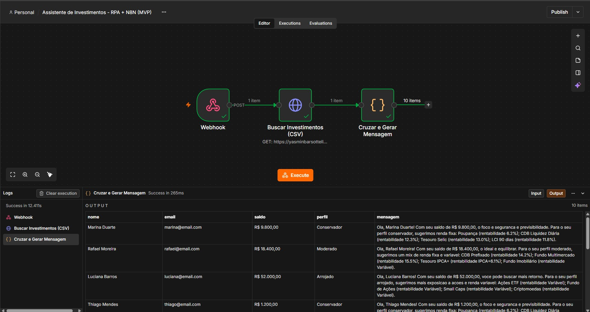

# Assistente de Investimentos com RPA e N8N

Projeto do desafio da DIO: um pipeline que coleta dados de clientes em uma página web com Python (RPA), envia para um workflow no N8N, cruza o perfil de cada cliente com uma base de investimentos e gera uma mensagem personalizada para cada um.

Esta é a entrega da **versão MVP**, com mensagens estáticas por perfil de investidor.

## Resultado



O print mostra o workflow executado com sucesso no N8N: o Webhook recebe 1 item (a lista de clientes), o CSV de investimentos é buscado e o node final devolve 10 itens, cada um com a mensagem pronta.

## Como funciona

1. **Páginas no GitHub Pages**: `docs/index.html` traz a tabela de clientes e `docs/data.csv` traz as opções de investimento por perfil.
2. **RPA em Python** (`rpa/extrair_clientes.ipynb`): acessa a página, lê a tabela com BeautifulSoup e envia a lista de clientes por POST para o Webhook do N8N.
3. **Workflow no N8N** (`n8n/workflow.json`): recebe os clientes pelo Webhook, busca o `data.csv`, cruza o perfil de cada cliente com os produtos do mesmo perfil e monta a mensagem.
4. **Saída**: uma mensagem personalizada para cada cliente (Conservador, Moderado ou Arrojado), com nome, saldo e os produtos recomendados com a rentabilidade de cada um.

## Estrutura do repositório

```
├── README.md
├── rpa/
│   └── extrair_clientes.ipynb   # script de RPA, com envio ao Webhook
├── n8n/
│   └── workflow.json            # workflow exportado do N8N
└── docs/
    ├── index.html               # página de clientes
    ├── data.csv                 # opções de investimento
    └── Print_desafio.jpg        # print do fluxo funcionando
```

## Decisões técnicas

**Dados próprios.** Troquei os clientes e a lista de investimentos do repositório base por dados fictícios meus, mantendo a mesma estrutura de colunas. As rentabilidades são ilustrativas.

**N8N local e RPA fora do Colab.** O N8N foi executado localmente (`localhost:5678`). Como o Google Colab roda na nuvem e não alcança o `localhost` do meu computador, executei o notebook no VS Code, na própria máquina. O Colab é só uma sugestão do roteiro para abrir o notebook, e o resultado é o mesmo.

**MVP com mensagens estáticas.** Cada perfil tem um template fixo: Conservador (renda fixa e segurança), Moderado (mix entre renda fixa e variável) e Arrojado (mais exposição a ações e renda variável). A lista de produtos de cada mensagem vem do `data.csv`.

**Cruzamento por perfil.** O node de código normaliza o texto do perfil (sem acento e em minúsculas) antes de comparar, para evitar falhas por diferença de escrita.

## Como reproduzir

1. Ative o GitHub Pages do repositório (Settings, Pages, branch `main`, pasta `/docs`).
2. No N8N, importe o `n8n/workflow.json` e confira se a URL do node "Buscar Investimentos (CSV)" aponta para o `data.csv` do seu Pages.
3. No node Webhook, copie a Test URL e clique em "Listen for test event".
4. No notebook `rpa/extrair_clientes.ipynb`, cole a URL na variável `N8N_WEBHOOK` e execute as células.
5. Veja o resultado no Output do último node do N8N.

Requisitos: Python 3 com `requests` e `beautifulsoup4` (o notebook já traz a célula de instalação).

## Próximos passos

Conectar um Agente de IA do N8N a um modelo de linguagem para gerar mensagens dinâmicas, considerando o contexto de cada cliente (etapa de desafio do roteiro).
